<p align="center"></p>

# Ignait Studio

> **Real-Time Full-Duplex Voice Translator, Tactical Audio Router & Cinematographic Media Dubber**  
> Diseñado e implementado por **Jhon Córdova Martínez (Cresko · VE)**.

Ignait es una aplicación de escritorio para Windows (con extensión de Chrome integrada) que realiza traducción de voz en tiempo real en dos escenarios distintos:

1. **Modo Gaming (Full-Duplex de Ultrabaja Latencia):** permite hablar en español por el micrófono y enviar voz traducida al inglés hacia el micrófono virtual del juego (*Helldivers 2*, *Squad*, *Arma Reforger*), mientras captura el audio de los compañeros por WASAPI Loopback, identifica hablantes y reproduce la traducción al español con paneo espacial 3D.
2. **Modo Media (Doblaje Cinematográfico en Navegador):** mediante una extensión de Chrome y un servidor local WebSocket/HTTP, captura el audio de pestañas de video (como YouTube), pre-lee subtítulos, separa hablantes y sintetiza doblaje en español con clonación de voz neuronal (**XTTS-v2** en GPU) manteniendo la sincronización con el reloj del video.

---

## 1. Cómo nació el proyecto y evolución técnica

Ignait comenzó como una herramienta práctica para resolver una barrera concreta en juegos tácticos cooperativos: poder comunicarse en tiempo real con escuadrones internacionales sin depender de traductores de texto ni perder la inmersión del audio posicional.

A partir de esa base en tiempo real (`WASAPI` + `Silero VAD` + `faster-whisper` + `NLLB-200` + `Kokoro-ONNX`), el proyecto evolucionó hacia **Ignait Studio**, incorporando una interfaz gráfica integrada (`pywebview`), control independiente de canales (silenciar solo mi voz o solo lo que escucho) y el **Modo Media** para doblar videos completos en el navegador con fidelidad cinematográfica.

### Problemas reales resueltos durante el desarrollo

| Desafío | Causa raíz | Solución implementada |
| :--- | :--- | :--- |
| **Choque de entornos y peso del binario** | El motor principal y PyInstaller corren en Python 3.13 sin PyTorch, mientras `coqui-tts` (XTTS-v2) requiere Python 3.12 + PyTorch CUDA. | Arquitectura **sidecar aislada**: `Ignait.exe` ejecuta `ignait/media/xtts_worker.py` en un subproceso dedicado (`.venv-media-tts`, Python 3.12.8) gestionado por `worker_client.py`, manteniendo ligero el binario principal. |
| **Presupuesto de VRAM (8 GB en RTX 5060)** | Cargar STT, traducción neuronal y XTTS-v2 simultáneamente en GPU saturaba la memoria. | `faster-whisper` y `XTTS-v2` (FP16) corren en GPU, mientras `NLLB-200-distilled-600M` INT8 (`CTranslate2`) corre en CPU con un impacto mínimo en latencia. |
| **Desfase y saltos al adelantar videos** | Un retardo fijo se desincroniza según el tiempo de síntesis o al hacer *seek* en YouTube. | Prefetch de subtítulos, ventana adaptativa, *auto-pacing* ligado al reloj del video y reinicio inmediato de cola/generación (`playback_gen`) al detectar saltos en la reproducción. |
| **Mutación de voz a mitad del video** | Un solo hablante se dividía en múltiples IDs (`spk_1..spk_7`) por ruido o clips cortos, y el muestreo de XTTS-v2 generaba deriva tímbrica o alucinaciones con etiquetas `[Music]`. | Histéresis de continuidad y confirmación en 2 turnos en `OnlineSpeakerTracker` (`speaker_id.py`), bloqueo estricto en modo 1 hablante, filtrado por energía/actividad vocal en `MediaSpeakerVoiceBank` (`speaker_bank.py`), recorte de silencio + normalización RMS en `_prepare_reference_audio`, precalentamiento de latentes, ajuste de muestreo (`temperature=0.40, top_k=30, top_p=0.74, repetition_penalty=10.0`) y sanitización de texto/transcripciones. |

---

## 2. Arquitectura del Sistema

```mermaid
flowchart TD
    subgraph Gaming["Modo Gaming (Full-Duplex Baja Latencia)"]
        Mic["Micrófono Físico"] -->|WASAPI| RB1["SPSCRingBuffer (Lock-Free)"]
        RB1 --> VAD1["Silero VAD v5 ONNX"]
        VAD1 --> STT1["faster-whisper"]
        STT1 --> MT1["NLLB-200 INT8 (CPU)"]
        MT1 --> TTS1["Kokoro-ONNX (Stealth Clone)"]
        TTS1 --> Cable["VB-Cable Input -> Juego"]

        Loop["Loopback Audio"] -->|WASAPI Loopback| RB2["SPSCRingBuffer"]
        RB2 --> VAD2["Silero VAD v5 ONNX"]
        VAD2 --> Diar["WeSpeaker CAM++ (Diarización & Paneo 3D)"]
        VAD2 --> STT2["faster-whisper"]
        STT2 --> MT2["NLLB-200 INT8"]
        MT2 --> TTS2["Kokoro-ONNX Multi-Voz"]
        Diar -.->|Pan L/R| HP["Auriculares"]
        TTS2 --> HP
    end

    subgraph Media["Modo Media (Chrome + XTTS-v2 Sidecar)"]
        Ext["Extensión Chrome (content.js / background.js)"] <-->|WebSocket /ws/media| Sess["MediaSession (session.py)"]
        Sess --> Bank["OnlineSpeakerTracker + MediaSpeakerVoiceBank"]
        Bank --> Worker["xtts_worker.py (Python 3.12.8 + CUDA FP16)"]
        Worker -->|Audio doblado sincronizado| Ext
    end
```



---

## 3. Estructura Principal del Proyecto

- `ignait/gui.py` & `ignait/ui_stitch.html`: Interfaz principal de Ignait Studio, servidor HTTP/WebSocket local y controles independientes de micrófono/audio.
- `ignait/audio/`: Captura/reproducción WASAPI (`streams.py`, `devices.py`) y buffer circular *lock-free* (`ring_buffer.py`).
- `ignait/vad/silero.py`: Detección de actividad vocal con Silero VAD v5 ONNX y *pre-roll*.
- `ignait/stt/whisper_engine.py`: Transcripción con `faster-whisper` y filtrado de alucinaciones/etiquetas no habladas.
- `ignait/mt/translator.py`: Traducción neuronal con `NLLB-200` vía `CTranslate2`.
- `ignait/diarization/speaker_id.py`: Seguimiento online de hablantes con histéresis, bloqueo de género y confirmación anti-fragmentación.
- `ignait/tts/kokoro_engine.py`: Síntesis rápida multi-voz y clonación ligera para Modo Gaming.
- `ignait/media/`: Orquestación de Modo Media (`session.py`, `speaker_bank.py`, `worker_client.py`, `xtts_worker.py`).
- `browser_extension/`: Extensión Manifest V3 para captura de audio de pestañas, lectura de subtítulos y reproducción sincronizada.
- `Ignait.spec`: Empaquetado distribuible con PyInstaller.

---

## 4. Requisitos e Instalación

### Requisitos Previos
- Windows 10/11 x64.
- GPU NVIDIA con soporte CUDA (probado en RTX 5060 de 8 GB VRAM).
- Python 3.13 para el entorno principal y Python 3.12 (`.venv-media-tts`) para el sidecar opcional de XTTS-v2.
- [VB-Audio Virtual Cable](https://vb-audio.com/Cable/) para enrutamiento de micrófono en Modo Gaming.

### Instalación del entorno principal
```powershell
git clone https://github.com/MCJ-A/Ignait.git
cd Ignait

python -m venv .venv
.\.venv\Scripts\activate
pip install --upgrade pip
pip install -e .
```

### Ejecución
```powershell
# Iniciar interfaz gráfica de Ignait Studio
.\.venv\Scripts\python.exe -m ignait.gui
```
Para usar el Modo Media en Chrome, carga la carpeta `browser_extension/` como extensión descomprimida en `chrome://extensions` (Modo desarrollador).

---

## 5. Pruebas y Verificación

La suite de pruebas unitarias e integración cubre buffer circular, calibración, guardas CSRF/HTTP, enrutamiento de canales, sincronización de subtítulos/seek y estabilidad de diarización:

```powershell
.\.venv\Scripts\pytest.exe -v
```

También se incluye configuración de integración continua en [`.github/workflows/ci.yml`](file:///c:/Users/jhonc/Desktop/Ignait/.github/workflows/ci.yml).

---

## 6. Potencial Futuro

- **Separación de fuentes (Voces vs. Música/SFX):** integrar un separador ligero en tiempo real previo a la clonación XTTS y al STT para escenas cinematográficas con música o efectos intensos de fondo.
- **Pruebas en vivo multijugador:** validar el comportamiento del Modo Gaming con múltiples voces simultáneas y ruido ambiental real en partidas en línea.
- **Soporte extendido para videollamadas:** aprovechar el enrutamiento de baja latencia de Kokoro para traducir llamadas en plataformas como Meet, Zoom o Teams con aislamiento por participante.
- **Instalador todo-en-uno:** empaquetar un instalador para Windows que automatice la creación del sidecar de Python 3.12 y la descarga de modelos sin pasos manuales.

